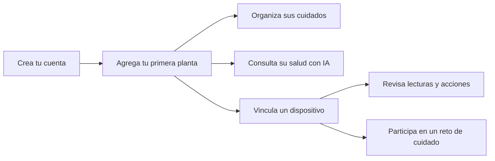
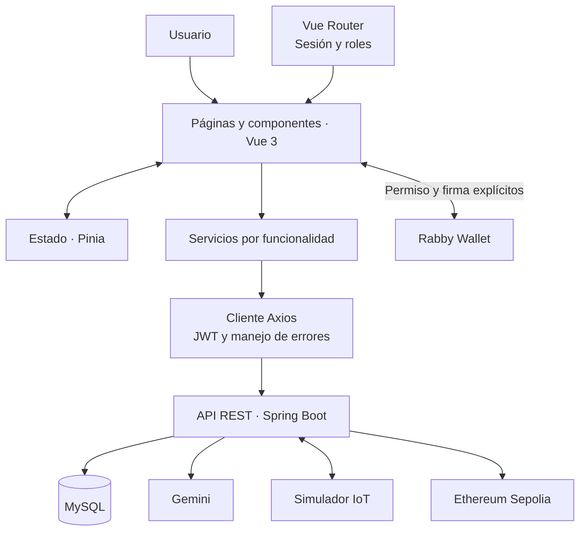

<div align="center">


# PlantSync · Web App

### Tu jardín, conectado contigo.

Una experiencia web de **NaturaTech** para conocer tus plantas, organizar sus cuidados y acompañar su crecimiento con inteligencia artificial e IoT.


[Abrir PlantSync](https://plantsync-app.netlify.app/) · [Explorar la demo](https://plantsync-app.netlify.app/preview/dashboard) · [Repositorio backend](https://github.com/1ASI0728-2620-9077-NaturaTech/NaturaTech-web-service)

</div>

---

## Acerca del proyecto

**PlantSync** convierte la información de un jardín en cuidados organizados. Desde una misma aplicación puedes registrar tus plantas, programar tareas, vincular dispositivos y consultar orientación basada en fotografías y conversaciones.

Este repositorio contiene la **aplicación web en Vue 3 y TypeScript**. Su diseño utiliza una identidad visual botánica, componentes compartidos y recorridos guiados para que una cuenta nueva pueda comenzar desde su primera planta.

## Un recorrido pensado para crecer



| Experiencia | Qué encontrarás |
|---|---|
| Mi jardín | Plantas en tarjetas o tabla, búsqueda, ficha individual y formulario de creación. |
| Cuidados | Tareas programadas, estados de cumplimiento y registro de cuidados completados. |
| Dispositivos | Alta de nodos, vinculación con plantas y consulta de su información. |
| Salud de plantas | Selección de fotografías, seguimiento del análisis y resultados con historial. |
| Asistente | Conversaciones contextualizadas y revisión de propuestas antes de confirmar acciones. |
| Medallas verdes | Conexión con Rabby, verificación por firma y seguimiento de retos de 30 días. |
| Administración | Vistas de usuarios y analítica reservadas al rol administrador. |

Los estados vacíos ofrecen una siguiente acción. El asistente guía hacia el registro de una planta cuando aún no existe ninguna; las recompensas explican la asociación con un dispositivo antes de iniciar un reto.

> **Datos reales y demostración:** las pantallas autenticadas consumen la API Spring Boot. Las rutas `/preview/*` son demostraciones aisladas con datos simulados; no prueban el funcionamiento de Gemini, dispositivos ni blockchain. Las integraciones reales dependen de las capacidades habilitadas por el backend.

## Arquitectura frontend

La aplicación se organiza por funcionalidades. Las páginas componen la interfaz, los servicios encapsulan el acceso HTTP y los modelos TypeScript describen los contratos de datos. Pinia administra el estado compartido y Vue Router controla la navegación según sesión y rol.



El frontend no se conecta directamente a MySQL ni contiene claves de los proveedores. La protección de rutas mejora la navegación, mientras que el backend valida los permisos y la propiedad de cada recurso.

### Organización del código

```text
src/
├── iam/                  # Acceso, registro y sesión
├── plant-management/     # Jardín y detalle de plantas
├── task-management/      # Cuidados y tareas
├── iot-management/       # Dispositivos y lecturas
├── profile-management/   # Perfil personal
├── analytics/            # Panel administrativo
├── chatbot/              # Acceso al chat
├── workspace/
│   ├── components/       # Componentes compartidos y onboarding
│   ├── pages/            # Salud, asistente, recompensas y demo
│   ├── services/         # Integración API y proveedor Rabby
│   └── __tests__/        # Pruebas de flujos
├── router/               # Rutas y controles de navegación
└── shared/               # Cliente HTTP y utilidades comunes

public/logo.png           # Identidad visual de PlantSync
```

## Stack tecnológico

| Responsabilidad | Tecnologías |
|---|---|
| Interfaz | Vue 3, Composition API, TypeScript |
| Componentes y estilos | PrimeVue 4, PrimeIcons, CSS compartido y adaptable |
| Navegación y estado | Vue Router 4, Pinia |
| Comunicación | Axios y API REST |
| Desarrollo | Vite 5, npm |
| Validación | Vitest, Vue Test Utils, jsdom, vue-tsc |
| Publicación | Netlify |

## Inicio local

**Requisitos:** Node.js 22 y npm, alineados con la configuración de Netlify. Para probar funciones reales, inicia también el [backend](https://github.com/1ASI0728-2620-9077-NaturaTech/NaturaTech-web-service).

```bash
git clone https://github.com/1ASI0728-2620-9077-NaturaTech/NaturaTech-web-app.git
cd NaturaTech-web-app
npm ci
npm run dev
```

Abre la dirección que muestra Vite, normalmente `http://localhost:5173`. En PowerShell con restricciones para scripts, utiliza `npm.cmd` en lugar de `npm`.

### Conexión con el backend

La configuración de desarrollo utiliza:

```dotenv
VITE_API_BASE_URL=/api/v1
```

Vite redirige `/api` a `http://127.0.0.1:8080`. Puedes cambiar ese destino mediante `BACKEND_PROXY_TARGET` antes de iniciar Vite.

Para consumir directamente otro entorno, define en `.env.local`:

```dotenv
VITE_API_BASE_URL=https://plantsync-backend.onrender.com/api/v1
```

Reinicia Vite después del cambio. El backend debe autorizar el origen desde el que abres la web. En producción, esta variable se incorpora durante el build: cambiarla requiere volver a compilar y desplegar.

**Las variables `VITE_*` son públicas.** No colocar claves Gemini, contraseñas MySQL, secretos IoT ni claves privadas blockchain en ellas.

## Navegación

| Ruta | Acceso | Propósito |
|---|---|---|
| `/sign-up`, `/sign-in` | Público | Crear una cuenta e iniciar sesión. |
| `/plants`, `/plants/:id` | Usuario | Jardín y detalle de una planta. |
| `/tasks` | Usuario | Planificación e historial de cuidados. |
| `/iot` | Usuario | Dispositivos vinculados. |
| `/health` | Usuario | Análisis de fotografías. |
| `/assistant` | Usuario | Asistente y propuestas de acciones. |
| `/rewards` | Usuario | Billetera, retos y medallas. |
| `/profile` | Usuario | Información del perfil. |
| `/dashboard`, `/users` | Administrador | Analítica y administración de usuarios. |
| `/preview/dashboard` | Público | Recorrido demostrativo sin credenciales. |

Tras iniciar sesión, los usuarios acceden a su jardín y los administradores al panel. Las solicitudes personales consultan los recursos de la cuenta autenticada.

## Integraciones y experiencia de uso

### Salud con Gemini

La fotografía se envía al backend como archivo, con una clave de idempotencia. La pantalla distingue carga, procesamiento, resultado y error; permite consultar el historial y reintentar un análisis fallido. Las recomendaciones expresan orientación e incertidumbre, no un diagnóstico garantizado.

### Asistente y dispositivos

El usuario elige una planta y consulta sus cuidados. Si se propone una acción, revisa su duración y la confirma explícitamente. La interfaz sigue el estado del comando; el servidor verifica el dispositivo, las lecturas recientes y los límites. Vincular un nodo no pone en marcha su simulador.

### Rabby y medallas

La web descubre el proveedor de Rabby, solicita conexión por iniciativa del usuario y verifica la dirección mediante un desafío firmado. Un cambio de cuenta o red invalida la conexión. La emisión de medallas utiliza **Ethereum Sepolia** y requiere configuración adicional del servidor; conectar la billetera no habilita por sí mismo las recompensas.

## Pruebas y compilación

```bash
npm run type-check
npm test
npm run build
npm run preview
```

Las pruebas cubren sesión y permisos de navegación, compatibilidad de funciones existentes, formularios, estados vacíos, recuperación de errores y flujos de integración con respuestas controladas. El build se genera en `dist/`.

Las pruebas de componentes no sustituyen la revisión visual, una firma con la extensión real ni la validación de Gemini, IoT o Sepolia contra servicios externos.

## Despliegue en Netlify

La configuración está versionada en [netlify.toml](netlify.toml):

- Node.js 22 y comando `npm run type-check && npm test && npm run build`.
- Directorio publicado: `dist`.
- Reescritura SPA para recargar rutas como `/plants` y `/rewards`.
- Cabeceras de protección del contenido y política de referencias.

Configura `VITE_API_BASE_URL` con la URL completa de la API y despliega. En el backend, el origen permitido debe coincidir con `https://plantsync-app.netlify.app` y el dominio de firma con `plantsync-app.netlify.app`. El proxy de Vite solo existe en desarrollo.

---

<div align="center">

**PlantSync · NaturaTech**

Un espacio para cuidar lo que crece.

</div>
